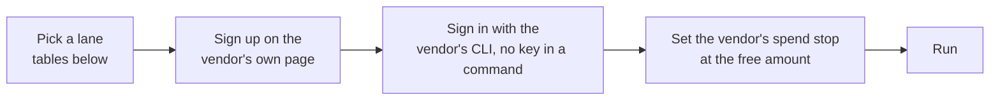

# Compute credits

Free compute anyone can get: GPU, CPU, inference, CI and hosting free tiers and sign-up credits. You do not need a startup or a company. Published by [Colorado-Compute](https://github.com/Colorado-Compute) under [Apache-2.0](LICENSE).

| Step | Do this |
| --- | --- |
| 1. Pick a lane | Find the compute you need in the tables below |
| 2. Set it up | Follow [the setup template](guides/setup-template.md) and the row's `setup_steps` in [`catalog/credits.json`](catalog/credits.json) |
| 3. Check the page | Every row was read on the vendor's own page on its `Read` date. A free tier changes without notice, so read the page before you sign up |

## What is here

| Path | What it is |
| --- | --- |
| [`catalog/`](catalog/README.md) | `credits.json`, one row per credit, and `check.py`, which guards every field |
| [`guides/setup-template.md`](guides/setup-template.md) | Pick a lane, sign up, sign in, set the spend stop, run |
| `tools/` | The text checks (JSON, no em dash, no email, no private path) and the secret scan |

## The credits

Rows are from `catalog/credits.json`, read between 2026-11-02 and 2026-11-12; each row's date is in its last column. "Past the amount" is what the vendor's page says happens at the limit: `stops`, `bills` or `unknown`. A `bills` row needs a spend stop before you run.

### GPU

| Credit | Free amount | Form | Card | Past the amount | Read |
| --- | --- | --- | --- | --- | --- |
| [AMD Developer Cloud complimentary credit](https://www.amd.com/en/developer/resources/cloud-access/amd-developer-cloud.html) | $100 of AMD Developer Cloud credit for AMD Instinct MI300X GPUs. It expires 30 days from deposit unless the credit confirmation email says otherwise. | Sign-up credit | No | bills | 2026-11-12 |
| [Comfy Cloud Free plan](https://comfy.org/pricing) | 5 free runs on real GPUs and free Comfy Agent credits for new users. | Sign-up credit | Not stated | stops | 2026-11-02 |
| [Hugging Face ZeroGPU (free account)](https://huggingface.co/docs/hub/spaces-zerogpu) | 5 minutes of ZeroGPU time per day on a free account (2 minutes unauthenticated) across any ZeroGPU Space. The default size is half an NVIDIA RTX Pro 6000 Blackwell with 48 GB VRAM. | Free tier | No | stops | 2026-11-02 |
| [Modal Starter](https://modal.com/pricing) | $30 per month of free compute (GPU, CPU, memory) for Functions and Sandboxes on the $0 Starter plan, with 3 workspace seats, 10 GPU concurrency and 100 containers. Shared Endpoint tokens bill from the first request. At the listed RTX PRO 6000 rate of $0.000842 a second, $30 buys about 9.9 GPU hours (computed here). | Free tier | Yes | bills | 2026-11-12 |

### CPU

| Credit | Free amount | Form | Card | Past the amount | Read |
| --- | --- | --- | --- | --- | --- |
| [AWS Free Tier credits (Free plan)](https://aws.amazon.com/free/) | $100 in credits at sign-up, and up to $100 more for exploring key services. The Free plan account closes 6 months after it opens or when the credits run out, whichever comes first. The Free plan is limited to select services and cannot scale workloads beyond the credit. It charges nothing unless you upgrade to a Paid plan or activate paid-only services. A Free plan account is not eligible for promotional credits; a Paid plan account is. | Sign-up credit | No | stops | 2026-11-12 |
| [Azure free account](https://azure.microsoft.com/en-us/pricing/purchase-options/azure-account) | A $200 credit for Azure services within 30 days, not spendable on Spot Virtual Machines. New customers also get free monthly amounts of 20+ services for 12 months and 65+ always-free services. | Sign-up credit | Yes | stops | 2026-11-12 |
| [Oracle Cloud Always Free (OCI Ampere A1 Compute)](https://docs.oracle.com/en-us/iaas/Content/FreeTier/freetier_topic-Always_Free_Resources.htm) | 1,500 OCPU hours and 9,000 GB hours per month on VM.Standard.A1.Flex (Arm), which Oracle states equals 2 OCPUs and 12 GB of memory. Also 200 GB of boot and block volume storage and up to two AMD E2.1.Micro VMs. | Free tier | Yes | stops | 2026-11-02 |
| [Oracle Cloud Free Trial credit](https://www.oracle.com/cloud/free/faq/) | A US$300 cloud credit, in select countries, valid for up to 30 days. Always Free services continue after the trial. | Sign-up credit | Yes | stops | 2026-11-12 |

### Inference

| Credit | Free amount | Form | Card | Past the amount | Read |
| --- | --- | --- | --- | --- | --- |
| [AssemblyAI free credit](https://support.assemblyai.com/articles/5370767329-can-i-sign-up-for-free) | Up to $50 of audio on a limited trial: pre-recorded transcription, Speech Understanding and streaming speech-to-text. | Sign-up credit | No | stops | 2026-11-02 |
| [Baseten new-customer credit (credit referral)](https://www.baseten.co/talk-to-us/credit-referral/) | $250 of Dedicated Inference or $100 of Model API credits, expiring 1 month after issue. The page does not say you get both. | Sign-up credit | Not stated | unknown | 2026-11-12 |
| [Cerebras Inference Free Trial](https://inference-docs.cerebras.ai/support/rate-limits) | $5 in credits after adding a verified payment method, valid 30 days across all public models, with gpt-oss-120b at 5 requests a minute and 1 million tokens a day. | Sign-up credit | Yes | stops | 2026-11-12 |
| [Cloudflare AI Search (formerly AutoRAG)](https://developers.cloudflare.com/ai-search/platform/limits-pricing/) | Monthly: 5 million ingestion tokens, 10 GB-month storage, 1,000 semantic queries and 1,000 full-text queries, on Workers Free and Workers Paid. | Free tier | Not stated | bills | 2026-11-02 |
| [Cloudflare Workers AI free daily allocation](https://developers.cloudflare.com/workers-ai/platform/pricing/) | 10,000 Neurons per day of Workers AI inference, on both Workers Free and Workers Paid. | Free tier | No | bills | 2026-11-02 |
| [Deepgram Startup Program](https://deepgram.com/startup-program) | $1,000 in Startup Program credits to start, with tiers worth up to $100,000 as you grow. Each credit grant expires 12 months after issue. Deepgram's Model Improvement Partnership Program page says some request data goes into model training unless a request sets mip_opt_out=true. | Sign-up credit | Not stated | unknown | 2026-11-12 |
| [ElevenLabs Free](https://elevenlabs.io/pricing) | 10,000 credits per month, about 10 minutes of text to speech (1 credit per character on V2 Multilingual), and 3 Studio projects. | Free tier | Not stated | unknown | 2026-11-02 |
| [GroqCloud Free plan](https://console.groq.com/docs/rate-limits) | A Free plan with per-model rate limits. Groq's rate-limits page names Free plan limits but shows only the Developer plan's base limits, such as whisper-large-v3 at 20 requests a minute, 2,000 requests a day and 28,800 audio seconds a day, so read your own limits in the console. | Free tier | Not stated | stops | 2026-11-12 |
| [Mistral Studio Free mode](https://docs.mistral.ai/getting-started/quickstarts/studio/activate-and-generate-api-key) | API access on a new Mistral Studio account in Free mode, enabled by default with no credit card. Rate limits apply; the docs give no numbers. | Free tier | No | stops | 2026-11-02 |
| [NVIDIA API Catalog trial (build.nvidia.com)](https://build.nvidia.com/) | Free inference on hosted models in the API Catalog, up to 40 requests a minute and 10,000 requests a day. | Free tier | Not stated | stops | 2026-11-02 |
| [OpenRouter free model variants (:free)](https://openrouter.ai/docs/api/reference/limits) | Free model variants (:free) at 20 requests a minute and 50 requests a day, or 1,000 a day after at least 10 credits purchased in all time. | Free tier | Not stated | stops | 2026-11-02 |

### CI

| Credit | Free amount | Form | Card | Past the amount | Read |
| --- | --- | --- | --- | --- | --- |
| [Blacksmith free tier](https://www.blacksmith.sh/pricing) | 3,000 x64 2 vCPU minutes per month per organization for GitHub Actions jobs. | Free tier | No | unknown | 2026-11-02 |
| [GitHub Actions on GitHub Free](https://docs.github.com/en/billing/concepts/product-billing/github-actions) | Standard GitHub-hosted runners in public repositories are free. Private repositories get $12 of included compute per month on GitHub Free; at $0.006 per Linux 2-core minute, that covers 2,000 minutes (computed here). | Free tier | No | stops | 2026-11-02 |

### Hosting

| Credit | Free amount | Form | Card | Past the amount | Read |
| --- | --- | --- | --- | --- | --- |
| [Cloudflare D1 on Workers Free](https://developers.cloudflare.com/d1/platform/pricing/) | 5 million rows read per day, 100,000 rows written per day, 5 GB total storage and 10 databases. | Free tier | Not stated | stops | 2026-11-02 |
| [Cloudflare R2 free tier](https://developers.cloudflare.com/r2/pricing/) | 10 GB-month storage, 1 million Class A operations and 10 million Class B operations per month, with free egress, on Standard storage. | Free tier | Not stated | bills | 2026-11-02 |
| [Cloudflare Workers Free plan](https://developers.cloudflare.com/workers/platform/pricing/) | 100,000 requests per day, 10 ms CPU time per invocation and 128 MB memory, plus Workers KV at 100,000 reads and 1,000 writes per day. | Free tier | Not stated | stops | 2026-11-02 |
| [GitHub Pages](https://docs.github.com/en/pages/getting-started-with-github-pages/github-pages-limits) | Static site hosting for public repositories. A published site is up to 1 GB, with a soft bandwidth limit of 100 GB per month and a soft limit of 10 builds per hour. | Free tier | Not stated | stops | 2026-11-02 |
| [Hugging Face Spaces CPU Basic](https://huggingface.co/docs/hub/spaces-overview) | Static Spaces are free for everyone. CPU Basic hardware is 2 vCPU, 16 GB RAM and 50 GB of non-persistent disk. | Free tier | Not stated | unknown | 2026-11-02 |
| [Supabase Free plan](https://supabase.com/pricing) | 2 active projects; per project a 500 MB database, 1 GB file storage, 5 GB egress, 50,000 monthly active users and 500,000 Edge Function invocations. | Free tier | Not stated | unknown | 2026-11-02 |
| [Vercel Hobby plan](https://vercel.com/pricing) | Per month: 1 million function invocations, 4 hours Fluid Active CPU, 1 million CDN requests and 100 GB Fast Data Transfer. | Free tier | Not stated | stops | 2026-11-02 |

### Sign-up credits for anyone

One-time sign-up credits that need no company, such as cloud trials, are the `Sign-up credit` rows in the tables above. Six of them, and the Modal and Cerebras facts merged into existing rows, moved here from the `no_incorporation` bucket of [Colorado-Startups/startup-credits](https://github.com/Colorado-Startups/startup-credits) on 2026-11-12. That repo keeps the programs that need a company, funding or an invitation.

### Discounts

The `discount` form is for a price cut a vendor's own page states. None is listed yet.

## Related

| Repo | Use |
| --- | --- |
| [SoulCraft-Org/compute-crafter](https://github.com/SoulCraft-Org/compute-crafter) | Open-weight models and tools setup: wire free compute to Claude Code and OpenCode |
| [Colorado-Startups/startup-credits](https://github.com/Colorado-Startups/startup-credits) | Startup programs: credits that need a company, funding or an invitation, and a matcher |
| [Colorado-Compute/compute-credits](https://github.com/Colorado-Compute/compute-credits) | This repo: free compute for anyone |

## Fix a credit

Open a pull request that edits `catalog/credits.json` and its row in this README. Set the row's `source` to the vendor page you read and `checked` to today. Run `python3 -I catalog/check.py --fix`, then `python3 -I catalog/check.py`. CI runs every check on the pull request.

No vendor paid to appear here, and Colorado-Compute is not a partner of any vendor listed. The list leaves out some vendors by policy.
