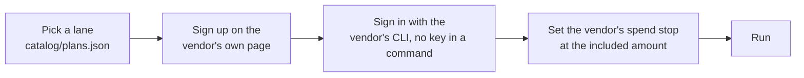

# Compute credits

The one public catalog of free credits, free tiers and subscriptions whose included usage is subsidized, in every lane: CI, CPU, GPU, inference, hosting and AI tools. You do not need a startup or a company. Published by [Colorado-Compute](https://github.com/Colorado-Compute) under [Apache-2.0](LICENSE).

## The catalog moved in

On 2026-11-24 the plan catalog and its tools moved here from [SoulCraft-Org/compute-crafter](https://github.com/SoulCraft-Org/compute-crafter). It replaces the 28-row `credits.json`. A fuller README with tables per lane comes in a later step.

| Lane | Rows |
| --- | --- |
| ci | 11 |
| cpu | 31 |
| gpu | 39 |
| inference | 32 |
| hosting | 16 |
| tools | 26 |
| **All** | **155** |

Counts are by each row's first lane, from [`catalog/plans.json`](catalog/plans.json). [`catalog/README.md`](catalog/README.md) lists the fields, the merge rules and the commands.

## What is here

| Path | What it is |
| --- | --- |
| [`catalog/`](catalog/README.md) | `plans.json`, one row per plan, and the README that defines each field |
| [`guides/setup-template.md`](guides/setup-template.md) | Pick a lane, sign up, sign in, set the spend stop, run |
| `tools/` | `catalog.py` builds and checks the catalog, `checks.py` runs the text checks, and the secret scan |

## Related

| Repo | Use |
| --- | --- |
| [SoulCraft-Org/compute-crafter](https://github.com/SoulCraft-Org/compute-crafter) | Open-weight models and tools setup: wire free compute to Claude Code and OpenCode |
| [Colorado-Startups/startup-credits](https://github.com/Colorado-Startups/startup-credits) | Startup programs: credits that need a company, funding or an invitation, and a matcher |
| [Colorado-Compute/compute-credits](https://github.com/Colorado-Compute/compute-credits) | This repo: free credits and subsidized plans for anyone |

## Fix a row

Open a pull request that edits `catalog/plans.json`. Set the row's `source` to the vendor page you read and `checked` to today. Run `python3 -I tools/catalog.py --format`, then `python3 -I tools/catalog.py --check`. CI runs every check on the pull request.

No vendor paid to appear here, and Colorado-Compute is not a partner of any vendor listed. The list leaves out some vendors by policy.
