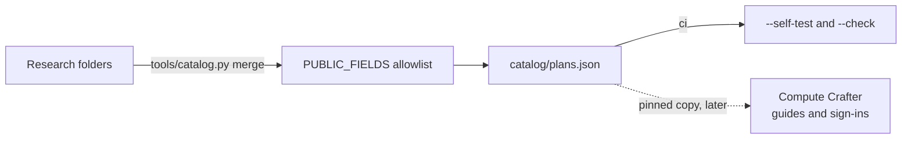

# Plan catalog

[plans.json](plans.json) is the one catalog of free credits, free tiers and subscriptions whose included usage is subsidized, for CI, CPU, GPU, inference, hosting and AI tools. Each row names the vendor page it was read on and the date. A fix lands here by pull request, never in a copy.

| Lane | Rows | Verified | Price 0 |
| --- | --- | --- | --- |
| ci | 11 | 11 | 7 |
| cpu | 31 | 31 | 9 |
| gpu | 39 | 38 | 7 |
| inference | 32 | 30 | 11 |
| hosting | 16 | 16 | 10 |
| tools | 26 | 26 | 7 |
| **All** | **155** | **152** | **51** |

Counts are by each row's first lane, from `plans.json` as moved in on 2026-11-24. Rows were read between 2026-11-20 and 2026-11-24.

## What a row is

| Kind of row | Example | What `includes` holds |
| --- | --- | --- |
| Free tier | An allowance that resets each day or month | The allowance in the page's terms |
| Sign-up credit | A one-time amount at sign-up | The amount and its expiry |
| Subsidized subscription | A paid plan whose included usage costs less than pay as you go | The included usage, with `unit_cost_vs_payg` beside it |

## Fields

| Field | Holds |
| --- | --- |
| `id` | Lowercase, unique |
| `name`, `provider`, `provider_hq` | The plan, its vendor, and the vendor's home country. `provider_hq` is an ISO 3166-1 alpha-2 code, or `null` |
| `lanes` | One or more of `ci`, `cpu`, `gpu`, `inference`, `hosting`, `tools` |
| `price_month`, `currency` | The monthly price in the currency the page states (ISO 4217), or `null` |
| `price_note`, `includes`, `resets`, `limits` | What the page says the plan gives, when it resets, and who or what limits it |
| `unit_cost_vs_payg` | The plan's unit cost against the vendor's own pay-as-you-go rate |
| `card` | `true` when the vendor wants a card on file |
| `overage` | `stops`, `bills`, `unknown`, or `null` when not read: what happens at the limit |
| `trains_on_data`, `commercial_use` | What the terms say, or `null` when not read |
| `source`, `sources_extra` | The first-party `https://` pages read |
| `checked` | The date the row was read, `YYYY-MM-DD`. It is a real calendar date, no later than tomorrow (UTC) |
| `verified` | `true`: every figure was read on `source` on `checked`. `false`: from older research, not re-read since. A `(3p)` mark in a `false` row means a third-party page |

`tools/catalog.py` keeps only these fields, in this order. A column a source adds never reaches this file.

## What stays out

| Left out | Why |
| --- | --- |
| A row with no first-party `source` or no `checked` date | Every figure carries its vendor page and read date |
| A closed plan | Nothing to sign up for |
| A pay-as-you-go rate with no free or subsidized part | Not what this catalog lists |
| Account ids, emails, balances, `cs_*` and `evidence` fields | Private. `tools/catalog.py` and `tools/checks.py` refuse them |
| Setup steps | Wiring lives in [Compute Crafter](https://github.com/SoulCraft-Org/compute-crafter)'s provider guides. [The setup template](../guides/setup-template.md) stays here as the generic flow |

## Merge

| Rule | Why |
| --- | --- |
| Rows merge by `id`; the newer `checked` wins | The newest read is the best fact |
| On a tie, the first source wins | Deterministic: the same input gives the same bytes |
| One `id` in two lanes keeps both lanes | A plan such as a Pro subscription serves two lanes |
| The winning row decides status | A plan closed since an older read stays out |
| Closed, excluded and `DROP` rows stay out | `DROP` in `tools/catalog.py` names each dropped id with its reason |

## Commands

| Command | What it does |
| --- | --- |
| `python3 -I tools/catalog.py --self-test` | Seeded good and bad catalogs that must pass or fail |
| `python3 -I tools/catalog.py --check` | The committed catalog is valid and canonical; CI runs this |
| `python3 -I tools/catalog.py --format` | Sorts the rows and rewrites the file canonically, then checks it |
| `python3 -I tools/catalog.py merge DIR [DIR ...]` | Merges each research folder into the catalog |
