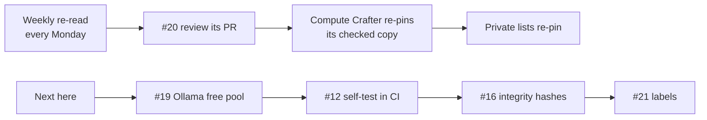

# Pick-up plan, 2026-11-25

State at the end of the 2026-11-24 session. Open work is on the [Compute Credits board](https://github.com/orgs/Colorado-Compute/projects/1) and in [issues](https://github.com/Colorado-Compute/compute-credits/issues).

## Where things stand

| Thing | State |
| --- | --- |
| Catalog | `catalog/plans.json` holds 170 rows, 66 of them free, counted on 2026-11-24 at commit `1e0d157`. It is the one public source since the move (#4) |
| Explorer | Live at [colorado-compute.github.io/compute-credits](https://colorado-compute.github.io/compute-credits/) (#8) |
| Weekly re-read | `catalog-reread.yml` runs keyless every Monday. The first run with stale rows falls about 2026-11-30 |
| Readers | Compute Crafter pins a checked copy in its `catalog/PIN`. Private lists pin a commit of this repo |
| Settings | Secret scanning, push protection, Dependabot, CodeQL extended, squash only, Pages and Discussions are on (SoulCraft-Org/compute-crafter#161) |
| Tracking | Every issue and merged PR is on the board |

## Next

| # | Do | Done when |
| --- | --- | --- |
| 1 | #20: review the first weekly re-read PR. Check each changed figure on its vendor page | merged |
| 2 | #19: add the Ollama free cloud pool row, read on Ollama's own pages | the row is in, or the issue records that no page names one |
| 3 | #12: run the re-read self-test in CI, and cover 400 and network errors | CI runs it |
| 4 | #16: subresource integrity for three.js and the font stylesheet | merged |
| 5 | #21: Git Crafter's labels plus `area:` labels. Dependabot PR #3 merged on 2026-11-24, so the shared CI pin is at Git Crafter v7.0.2 | every open issue has an area |

## Waiting on others

| Item | Waits on |
| --- | --- |
| Startup programs (Databricks for Startups, the three-doors README) | Colorado-Startups/startup-credits PRs #10 and #11, which that org's agents merge |
| The re-pin after each catalog merge | SoulCraft-Org/compute-crafter#209 takes the new commit |

## Decided by the owner, 2026-11-24

| Decision | Detail |
| --- | --- |
| Three repos, three jobs | This repo lists free credits and subsidized subscriptions. Programs a company applies to go to startup-credits. Wiring goes to Compute Crafter |
| Money | A row may carry a price. Pay per token is never recommended |
| Visual first | The README and the Explorer lead with visuals. Words only where a visual cannot carry it |
| Names | The OpenCode Desktop App and the Claude Desktop App (Code and Cowork). Superseded 2026-11-26: Compute Crafter wires open weights into OpenCode only |

## Traps

| Trap | Do |
| --- | --- |
| A vendor page changes between reads | Read it live and date it. A third-party page never verifies a figure |
| A local checkout behind `main` shows stale files | Run `git pull --ff-only` before judging what the repo holds |
| Workers drop facts when they trim | Check the diff against the claims ledger |

Start a session in this folder with: "Read `docs/handoff/2026-11-25-next.md` and work the Next table top down."
