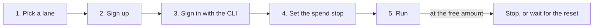

# Setup template

One path for every credit in [`catalog/credits.json`](../catalog/credits.json). Each row's `setup_steps` fills in the vendor's own names for these steps.

| Step | Do this | Never |
| --- | --- | --- |
| 1. Pick a lane | Choose the `kind` you need: `gpu`, `cpu`, `inference`, `ci` or `hosting`. Prefer a row whose `overage` is `stops`: the vendor halts usage at the limit | Pick a `bills` row you cannot cap |
| 2. Sign up | Open the row's `source` page and create the account there. Read the page first: amounts and rules change. Check `who_qualifies` and `card_required` | Sign up through a third-party link |
| 3. Sign in | Use the vendor's CLI login, which opens a browser (OAuth) or prompts for a token. Where the vendor has only an API key, create it in its console and keep it in your keychain or a secret store. Commands name an env var, never a value | Paste a key into a command, a script, a shell profile or a chat |
| 4. Set the spend stop | Set the vendor's own spend limit or budget at the free amount. With no card on file, most free tiers block usage at the limit. Where the page names no cap, stop at the free amount yourself | Leave a card on file with no limit set |
| 5. Run | Run a small job first and read the vendor's usage page. Watch the `resets` period: `daily`, `weekly`, `monthly`, or `one_time` for a sign-up credit | Buy credits or top up past the free amount |

## Worked example

The `cloudflare-workers-ai-free` row, as its `setup_steps` give it:

| Step | Command or action |
| --- | --- |
| Sign up | Create a Cloudflare account |
| Sign in | `npx wrangler login` opens the browser; no key is typed |
| Spend stop | Stay on Workers Free. Cloudflare's Workers AI pricing page (read 2026-11-02) says use past the daily allocation fails with an error there |
| Run | Call a model from a Worker, then check the usage page |

## When a row is wrong

A page that disagrees with a row wins. Open a pull request that fixes the row, with the page as `source` and today as `checked`. [The catalog README](../catalog/README.md) has the fields.
